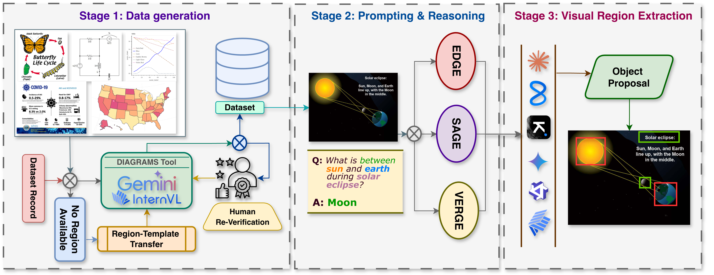

# DRAGON:A Benchmark for Evidence-Grounded Visual Reasoning over Diagrams

This directory contains the inference and evaluation code for the paper **"DRAGON: A Benchmark for Evidence-Grounded Visual Reasoning over Diagrams"**.



---

## Repository Structure

```
DRAGON/
├── data_preprocessing/
│   ├── data_loading.py         # Builds batches/*.json from the raw dataset
│   └── data_preprocessing.py  # Image resizing
│
├── prompts/
│   ├── prompts_edge.py         # EDGE prompt template
│   ├── prompts_sage.py         # SAGE Stage 1 + Stage 2 prompt templates
│   ├── prompts_verge.py        # VERGE Verify & Refine prompt template
│   └── worked_examples.py      # Few-shot examples per dataset
│
├── Inference/
│   ├── aws_bedrock/            # AWS Bedrock inference
│   │   ├── claude_llama_edge.py    # EDGE  — Claude / Llama4
│   │   ├── claude_llama_sage.py    # SAGE  — Claude / Llama4
│   │   ├── claude_llama_verge.py   # VERGE — Claude / Llama4
│   │   ├── kimi_edge.py            # EDGE  — Kimi K2.5
│   │   ├── kimi_sage.py            # SAGE  — Kimi K2.5
│   │   ├── kimi_verge.py           # VERGE — Kimi K2.5
│   │   └── parse_results.py        # Download + parse Bedrock batch results
│   │
│   ├── gcp/                    # Google Vertex AI inference
│   │   ├── gemini_edge_submit.py   # EDGE  — Gemini
│   │   ├── gemini_sage_submit.py   # SAGE  — Gemini
│   │   ├── gemini_verge_submit.py  # VERGE — Gemini
│   │   └── gemini_parse_results.py # Download + parse Vertex batch results
│   │
│   └── open_source/            # H200 GPU inference (HuggingFace)
│       ├── gemma3_edge.py          # EDGE  — Gemma3-27B
│       ├── qwen3_5_edge.py         # EDGE  — Qwen3.5-35B
│       ├── internvl_edge.py        # EDGE  — InternVL3-38B
│       ├── sage_inference.py       # SAGE  — all 3 models via --model flag
│       └── verge_inference.py      # VERGE — all 3 models via --model flag
│
└── eval_script.py              # Evaluation metrics (IoU, hit-rate, F1)
```

---

## Prompting Strategies

| Strategy | Description |
|----------|-------------|
| **EDGE** | Single-turn direct grounding — the model returns bounding boxes in one shot |
| **SAGE** | Two-stage: Stage 1 *selects* relevant visual elements, Stage 2 *grounds* them with bounding boxes |
| **VERGE** | Two-stage: Stage 1 produces initial grounding, Stage 2 *verifies* and *refines* the coordinates |

---

## Models

| Model | Provider | Scripts |
|-------|----------|---------|
| Claude Sonnet 4.6 | AWS Bedrock (batch) | `Inference/aws_bedrock/claude_llama_*.py` |
| Claude Opus 4.6 | AWS Bedrock (batch) | `Inference/aws_bedrock/claude_llama_*.py` |
| Llama 4 Maverick 17B | AWS Bedrock (batch) | `Inference/aws_bedrock/claude_llama_*.py` |
| Kimi K2.5 | AWS Bedrock (realtime) | `Inference/aws_bedrock/kimi_*.py` |
| Gemini 3 Pro | Google Vertex AI (batch) | `Inference/gcp/gemini_*.py` |
| Gemma3-27B-IT | H200 (HuggingFace) | `Inference/open_source/gemma3_edge.py` |
| Qwen3.5-35B-A3B | H200 (HuggingFace) | `Inference/open_source/qwen3_5_edge.py` |
| InternVL3-38B | H200 (HuggingFace) | `Inference/open_source/internvl_edge.py` |

---

## End-to-End Workflow

The full pipeline has three steps: **data preprocessing → inference → evaluation**.
All commands below should be run from the `DRAGON/` directory.

---

### Step 1 — Data Preprocessing

`data_loading.py` reads the raw DRAGON dataset (annotations + images) and builds one JSON batch file per dataset under `./batches/`. These batch files are the input consumed by every inference script.

The script expects:
- `./split_reviewed/Test/` — the test-split annotation JSONs
- `./Diagram_Attribution_Dataset/` — the raw images

```bash
python data_preprocessing/data_loading.py
```

This writes:
```
batches/
├── ai2d.json
├── ChartQA.json
├── Circuit-VQA.json
├── Infographics.json
├── MapIQ.json
└── MapWise.json
```

Run this **once**. The same batch files are reused by all models and all strategies.

---

### Step 2 — Inference

Pick the model and strategy you want to run. All inference scripts write `pred_<dataset>.json` files to an output directory of your choice.

#### AWS Bedrock — Claude Sonnet / Opus / Llama 4

**Prerequisites:** `pip install boto3 pillow`
**Auth:** AWS credentials via env vars or `~/.aws/credentials`
**IAM role** must trust `bedrock.amazonaws.com` with S3 read/write and `bedrock:CreateModelInvocationJob`

Switch models with `--model_id`:
- Claude Sonnet: `us.anthropic.claude-sonnet-4-6` (default)
- Claude Opus: `us.anthropic.claude-opus-4-6`
- Llama 4 Maverick: `us.meta.llama4-maverick-17b`

**EDGE** (single batch job)
```bash
python Inference/aws_bedrock/claude_llama_edge.py \
    --role_arn <YOUR_IAM_ROLE_ARN> \
    --bucket <YOUR_S3_BUCKET> \
    --model_id us.anthropic.claude-sonnet-4-6

# Once the job completes, download and parse results:
python Inference/aws_bedrock/parse_results.py \
    --jobs_file ./bedrock_jobs/jobs_TIMESTAMP.json \
    --pred_dir ./predictions/claude_sonnet_edge/
```

**SAGE** (two sequential batch jobs)
```bash
python Inference/aws_bedrock/claude_llama_sage.py phase1 \
    --role_arn <YOUR_IAM_ROLE_ARN> --model_id us.anthropic.claude-sonnet-4-6

python Inference/aws_bedrock/claude_llama_sage.py phase2 \
    --jobs_file ./bedrock_jobs/jobs_TIMESTAMP.json --role_arn <YOUR_IAM_ROLE_ARN>

python Inference/aws_bedrock/claude_llama_sage.py finalize \
    --jobs_file ./bedrock_jobs/jobs_TIMESTAMP.json \
    --pred_dir ./predictions/claude_sonnet_sage/
```

**VERGE** (two sequential batch jobs)
```bash
python Inference/aws_bedrock/claude_llama_verge.py phase1 \
    --role_arn <YOUR_IAM_ROLE_ARN> --model_id us.anthropic.claude-sonnet-4-6

python Inference/aws_bedrock/claude_llama_verge.py phase2 \
    --jobs_file ./bedrock_jobs/jobs_TIMESTAMP.json --role_arn <YOUR_IAM_ROLE_ARN>

python Inference/aws_bedrock/claude_llama_verge.py finalize \
    --jobs_file ./bedrock_jobs/jobs_TIMESTAMP.json \
    --pred_dir ./predictions/claude_sonnet_verge/
```

---

#### AWS Bedrock — Kimi K2.5

Kimi uses the **realtime** `invoke_model` API (no batch API available). Inference is parallelized via threading.

```bash
# EDGE
python Inference/aws_bedrock/kimi_edge.py \
    --model_id moonshotai.kimi-k2.5 \
    --pred_dir ./predictions/kimi_edge/

# SAGE
python Inference/aws_bedrock/kimi_sage.py \
    --model_id moonshotai.kimi-k2.5 \
    --pred_dir ./predictions/kimi_sage/

# VERGE
python Inference/aws_bedrock/kimi_verge.py \
    --model_id moonshotai.kimi-k2.5 \
    --pred_dir ./predictions/kimi_verge/
```

---

#### Google Vertex AI — Gemini 3 Pro

**Prerequisites:** `pip install google-genai google-cloud-storage pillow`
**Auth:** `gcloud auth application-default login` or set `GOOGLE_APPLICATION_CREDENTIALS`

**EDGE**
```bash
python Inference/gcp/gemini_edge_submit.py \
    --project_id <YOUR_GCP_PROJECT_ID> \
    --gcs_bucket <YOUR_GCS_BUCKET>

python Inference/gcp/gemini_parse_results.py \
    --jobs_file ./gemini_jobs/jobs_TIMESTAMP.json \
    --pred_dir ./predictions/gemini_edge/
```

**SAGE**
```bash
python Inference/gcp/gemini_sage_submit.py phase1 \
    --project_id <YOUR_GCP_PROJECT_ID> --gcs_bucket <YOUR_GCS_BUCKET>

python Inference/gcp/gemini_sage_submit.py phase2 \
    --jobs_file ./gemini_jobs/jobs_TIMESTAMP.json \
    --project_id <YOUR_GCP_PROJECT_ID> --gcs_bucket <YOUR_GCS_BUCKET>

python Inference/gcp/gemini_sage_submit.py finalize \
    --jobs_file ./gemini_jobs/jobs_TIMESTAMP.json \
    --pred_dir ./predictions/gemini_sage/
```

**VERGE**
```bash
python Inference/gcp/gemini_verge_submit.py phase1 \
    --project_id <YOUR_GCP_PROJECT_ID> --gcs_bucket <YOUR_GCS_BUCKET>

python Inference/gcp/gemini_verge_submit.py phase2 \
    --jobs_file ./gemini_jobs/jobs_TIMESTAMP.json \
    --project_id <YOUR_GCP_PROJECT_ID> --gcs_bucket <YOUR_GCS_BUCKET>

python Inference/gcp/gemini_verge_submit.py finalize \
    --jobs_file ./gemini_jobs/jobs_TIMESTAMP.json \
    --pred_dir ./predictions/gemini_verge/
```

---

#### Open-Source Models

**Prerequisites:** `pip install torch transformers pillow tqdm`

**EDGE** (one dedicated script per model)
```bash
python Inference/open_source/gemma3_edge.py \
    --checkpoint google/gemma-3-27b-it \
    -b ./batches/ -o ./predictions/gemma3_edge/

python Inference/open_source/qwen3_5_edge.py \
    --checkpoint Qwen/Qwen3.5-35B-A3B \
    -b ./batches/ -o ./predictions/qwen3_5_edge/

python Inference/open_source/internvl_edge.py \
    --checkpoint OpenGVLab/InternVL3-38B \
    -b ./batches/ -o ./predictions/internvl_edge/
```

**SAGE** (single script, select model via `--model`)
```bash
python Inference/open_source/sage_inference.py \
    --model gemma3 \
    --checkpoint google/gemma-3-27b-it \
    -b ./batches/ -o ./predictions/gemma3_sage/
# --model options: gemma3 | qwen3_5 | internvl
```

**VERGE** (single script, select model via `--model`)
```bash
python Inference/open_source/verge_inference.py \
    --model gemma3 \
    --checkpoint google/gemma-3-27b-it \
    -b ./batches/ -o ./predictions/gemma3_verge/
# --model options: gemma3 | qwen3_5 | internvl
```

All open-source scripts support `--save_every N` for checkpoint-style resume on long runs and `--max_samples N` for quick testing.

---

### Step 3 — Evaluation

Once inference is complete, point `eval_script.py` at the prediction directory:

```bash
python eval_script.py \
    --pred_dir ./predictions/<model_strategy>/ \
    --out_dir  ./results/<model_strategy>/
```

Results are written to `--out_dir` (defaults to `<pred_dir>/eval/` if omitted). A combined summary across all datasets is saved as `all_datasets_summary.json`.

**Metrics reported:**
- **Max-Pair IoU (MPIoU)** — bounding box overlap per sample
- **Grounding IoU (GIoU)** — set-level IoU treating all predicted and ground-truth boxes as groups
- **Hit-rate @ τ** for τ ∈ {0.1, 0.3, 0.5, 0.7} — fraction of samples with IoU above threshold (reported for both MaxIoU and GIoU)
- **Recall / Precision / F1** — element-level matching

---

## Prediction Format

All inference scripts write `pred_<dataset>.json` files — a list of dicts with:

```json
{
  "sample_id": "uid::...::qid::...::img::...",
  "uid": "...",
  "dataset": "...",
  "question_text": "...",
  "gt_boxes_raw": [[x, y, w, h], ...],
  "pred_raw_reply": "<full model output>",
  "pred_answer_str": "A_01/100,200,50,30, ...",
  "pred_boxes_parsed": [{"id": "A_01", "x": 100, "y": 200, "w": 50, "h": 30}],
  "pred_parse_errors": []
}
```

This format is identical across all models and strategies, so `eval_script.py` works unchanged for all.


